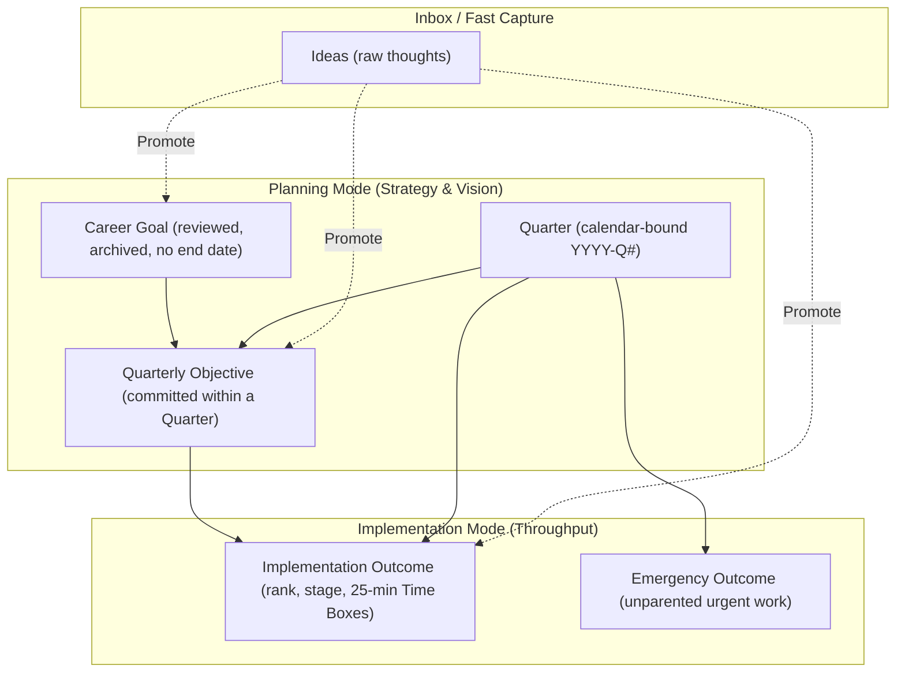
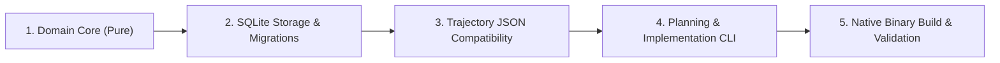

# Rocket Architectural Specification & Implementation Plan

A single-user Command Line Interface (CLI) tool for setting long-term career ambitions, committing quarterly objectives, and executing implementation outcomes with upward traceability.

Built to mirror the domain rules and JSON schema of [trajectory](https://github.com/kchapl/trajectory) while strictly adhering to the domain vocabulary in [CONTEXT.md](file:///home/kelvin/code/rocket/CONTEXT.md).

---

## 1. Core Principles & Domain Architecture



### The Three Tiers (from [CONTEXT.md](file:///home/kelvin/code/rocket/CONTEXT.md))

1. **Career Goal**:
   - Long-term ambition outliving any single Quarter (e.g., *"become a staff engineer"*).
   - Has no completion date; reviewed, not closed.
   - Archived rather than deleted so associated historical work is never orphaned.
2. **Quarterly Objective**:
   - Concrete result committed to within one Quarter (`YYYY-Q#`).
   - Progress is derived entirely from its component Implementation Outcomes.
   - Strictly links to a Career Goal for full upward traceability.
3. **Implementation Outcome**:
   - The bottom tier and sole unit of work to be achieved.
   - Belongs to a Quarter and an Objective (or parentless only if flagged as an `emergency`).
   - Managed by ordered `rank`, lifecycle `status` (`open`, `achieved`, `dropped`), and work `stage` (`todo`, `doing`, `achieved`).
   - Effort is tracked via completed **Time Boxes** (25 minutes each).

---

## 2. Technical Stack & Environment

- **Language**: Scala 3
- **Tooling**: `scala-cli` (installed via `mise`)
- **Compilation Target**: GraalVM Native Image / Scala Native for sub-50ms CLI startup.
- **Persistence**: SQLite stored at `~/.local/share/rocket/rocket.db`.
- **Interchange & Portability**: 100% JSON compatibility with `kchapl/trajectory` (`schemaVersion: 1`).
- **Formatting**: ANSI-colored terminal hierarchy views by default; global `--json` flag on read commands for Unix pipelines.

---

## 3. CLI Command Surface

The CLI operates across two distinct operational modes:

### Mode A: Planning Mode (`strategy & vision`)

| Command | Purpose |
|---|---|
| `rocket career list [--archived]` | List active or archived Career Goals |
| `rocket career add <title>` | Create a new Career Goal |
| `rocket career rename <id> <title>` | Rename a Career Goal |
| `rocket career archive <id>` / `unarchive <id>` | Archive or unarchive a Career Goal |
| `rocket quarter [current \| list]` | Show current quarter details or list known quarters |
| `rocket quarter review [quarter]` | Inspect Gaps (unaligned goals, empty objectives, parentless outcomes) |
| `rocket impl add --objective <id> <title>` | Plan a new Implementation Outcome under an Objective |
| `rocket impl add --emergency <title>` | Add an unparented emergency outcome |
| `rocket impl parent <outcome-id> <objective-id>` | Attach an outcome to an objective (clears emergency mark) |
| `rocket inbox list` | List unpromoted raw ideas |
| `rocket inbox add <text>` | Capture an idea quickly |
| `rocket inbox promote <id> [--to-goal \| --to-obj <goal-id> \| --to-out]` | Convert an idea into a goal, objective, or outcome |
| `rocket inbox discard <id>` | Remove an idea |

### Mode B: Implementation Mode (`efficient throughput`)

| Command | Purpose |
|---|---|
| `rocket backlog [list] [--all]` | View the ranked backlog of outcomes for the current quarter |
| `rocket backlog reorder <id> <+N \| -N>` | Adjust priority rank of an outcome |
| `rocket progress start <id>` | Move outcome stage from `todo` to `doing` |
| `rocket progress box <id>` | Record a completed 25-minute Time Box (increments effort and sets stage to `doing`) |
| `rocket progress achieve <id>` | Mark an outcome as achieved (terminal state) |
| `rocket progress drop <id>` | Drop an outcome (effort is retained in quarter totals) |

### Utility & Portability

| Command | Purpose |
|---|---|
| `rocket export [--output <file.json>]` | Export complete state to `trajectory`-compatible JSON |
| `rocket import <file.json>` | Import a `trajectory` JSON document into the local SQLite store |
| `rocket trace [outcome-id]` | Show full upward lineage: Outcome $\rightarrow$ Objective $\rightarrow$ Career Goal |

---

## 4. Entity Identification Strategy

- Short prefixed identifiers:
  - `g1`, `g2`, ... for Career Goals
  - `obj1`, `obj2`, ... for Quarterly Objectives
  - `out1`, `out2`, ... for Implementation Outcomes
  - `idea1`, `idea2`, ... for Ideas
- Case-insensitive prefix/fuzzy title matching when targeting an entity in commands.

---

## 5. Automatic Quarter Rollover

When `rocket` executes its first command in a new calendar Quarter:
1. Calculates elapsed quarters since `carriedThrough`.
2. Automatically carries forward all unachieved open Outcomes into the current Quarter (recording `carriedIn` boxes).
3. Copies forward parent Objectives that have at least one unachieved Outcome.
4. Updates `carriedThrough` and prints a one-line notification:
   ```text
   Notice: 2026-Q3 closed. Carried forward 4 open outcomes into 2026-Q4.
   ```

---

## 6. Implementation Milestones



1. **Phase 1: Pure Domain Model**
   - Port the pure domain logic from `trajectory` (`Quarter`, `CareerGoal`, `QuarterlyObjective`, `ImplementationOutcome`, `TimeBox`, `Gap`, `CarryForward`).
   - Pure unit tests verifying state transitions, rank ordering, gap analysis, and carry-forward rules.
2. **Phase 2: SQLite Storage Engine**
   - SQLite schema initialization in `~/.local/share/rocket/rocket.db`.
   - ID allocation (`g#`, `obj#`, `out#`, `idea#`) and atomic transaction handling.
3. **Phase 3: Trajectory JSON Importer / Exporter**
   - Serde/JSON codecs to serialize and deserialize `trajectory` JSON documents (`SCHEMA_VERSION = 1`).
4. **Phase 4: CLI Application & Presentation**
   - Mode parsers: `career`, `quarter`, `impl`, `inbox`, `backlog`, `progress`, `trace`.
   - Colorized tables and trees with `--json` option.
5. **Phase 5: Packaging & Performance**
   - Scala CLI packaging configuration with GraalVM Native Image for sub-50ms execution.
