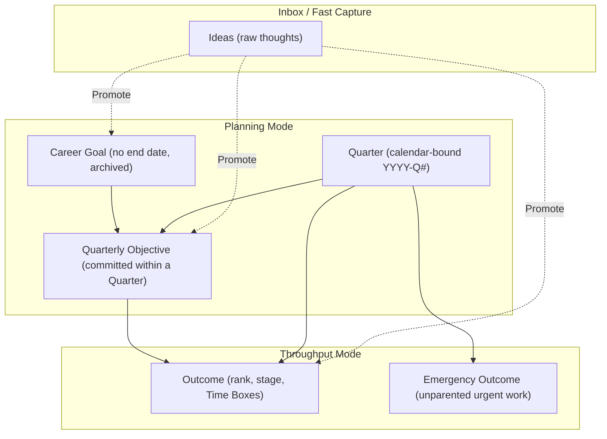

# Rocket Architectural Specification & Implementation Plan

A single-user Command Line Interface (CLI) tool for setting long-term career ambitions, committing quarterly objectives, and executing outcomes with upward traceability.

Built to mirror the domain rules and JSON schema of [trajectory](https://github.com/kchapl/trajectory) while strictly adhering to the domain vocabulary in [CONTEXT.md](CONTEXT.md).

---

## 1. Core Principles & Domain Architecture



### Data Shape

The tier definitions and the words for them are owned by [CONTEXT.md](CONTEXT.md) and are not restated here. This section records only the shape each tier and Idea takes as data, which the glossary deliberately does not describe.

**Quarter** is not a table. It is a value stamped on Outcomes and on Time Boxes, and the set of known Quarters is the union of those two, so a Quarter stays in the record as long as any Time Box was recorded in it — carrying the last Outcome out of a Quarter does not erase it. `carriedThrough` is a single setting, not a Quarter row.

1. **Career Goal**: never deleted. Archived instead, so historical work is never orphaned; there is no delete path. Carries a `why` and an ordered list of **Verification** statements, both optional.
2. **Quarterly Objective**: no progress column and no status column. Its stored facts are a title, a Goal, a Quarter, a `why` and its **Verification** statements, and nothing else. Progress is computed from its component Outcomes, and the Objective links to a Career Goal for upward traceability. Whether it is live (has an `open` Outcome), met (every Outcome `achieved`), abandoned (every Outcome `dropped`) or empty (no Outcomes) is derived at read time; a mix of achieved and dropped Outcomes is reported as counts rather than as a state. Verification statements here are prose, never ticked off: an Objective earns no progress of its own from them.
3. **Outcome**: belongs to a Quarter and, once filed, an Objective. It may be parentless in exactly two ways — flagged as an `emergency`, or promoted from an Idea before an Objective was chosen, which is the Parentless Outcome gap. Unless it is flagged `emergency` it also carries a `why` and an ordered list of **Verification** statements; an emergency Outcome carries neither. Carries `rank` — a position in its Quarter's single backlog queue — lifecycle `status` (`open`, `achieved`, `dropped`) and work `stage` (`todo`, `doing`); completed **Time Boxes** are separate records pointed at it, each stamped with the Quarter it was recorded in. No count is stored: an Outcome's total effort, its `carriedIn` count (boxes recorded before its current Quarter) and a Quarter's total are all derived from those records. `status` is the sole record of achievement and answers every "is this done?" question; `stage` tracks work in flight and has no terminal value. Once `status` is terminal, `stage` freezes and no further Time Box may be recorded. If `trajectory`'s schema requires an `achieved` stage, project it at the export boundary rather than storing it.
4. **Idea**: no Quarter and no parent, ever. Carries a `disposition` (`pending`, `promoted`, `discarded`) and, once promoted, the id of what it became — a `promoted` disposition and a non-null target always agree. Ideas are never deleted: a discarded Idea is the record of a decision, not garbage.

---

## 2. Technical Stack & Environment

- **Language**: Scala 3
- **Tooling**: `scala-cli` (installed via `mise`)
- **Compilation Target**: GraalVM Native Image / Scala Native for sub-50ms CLI startup.
- **Persistence**: SQLite stored at `~/.local/share/rocket/rocket.db`.
- **Interchange & Portability**: 100% JSON compatibility with `kchapl/trajectory` (`schemaVersion: 1`).
- **Formatting**: ANSI-colored terminal hierarchy views by default; global `--json` flag on read commands for Unix pipelines.

---

## 3. CLI Command Surface

The CLI operates across two distinct operational modes:

The two modes group commands by intent; they are not state the tool holds. No mode is ever "current": a command means the same thing on the hundredth run as on the first, so a pipeline cannot be changed by what was typed before it. Every command belongs to exactly one mode, and the names exist so that the two workflows can be described and a new command can be placed without guessing.

### Mode A: Planning Mode (`strategy & vision`)

| Command | Purpose |
|---|---|
| `rocket career list [--archived]` | List active or archived Career Goals |
| `rocket career add <title> [--why <text>] [--verification <text>]...` | Create a new Career Goal |
| `rocket career rename <id> <title>` | Rename a Career Goal |
| `rocket career archive <id>` / `unarchive <id>` | Archive a Goal once nothing under it is `open`, or return it to pursuit |
| `rocket quarter [current \| list]` | Show the current Quarter, or list the Quarters present in the record |
| `rocket quarter review [quarter]` | Report the Quarter's Gaps: Unaligned Goals, Empty Objectives, Parentless Outcomes |
| `rocket objective add <title> --goal <id> [--why <text>] [--verification <text>]...` | Commit a new Quarterly Objective to the current Quarter |
| `rocket objective drop <id>` | Drop an Objective by dropping every `open` Outcome under it, in one transaction |
| `rocket outcome add --objective <id> <title> [--why <text>] [--verification <text>]...` | Plan a new Outcome under an Objective |
| `rocket outcome add <title> [--why <text>] [--verification <text>]...` | Plan an unfiled Outcome — parentless and unflagged |
| `rocket outcome add --emergency <title>` | Add an unparented emergency Outcome |
| `rocket outcome parent <outcome-id> <objective-id>` | Set the Outcome's Objective, whether it had none or a different one; clears the emergency flag, and keeps no record of the previous parent |
| `rocket inbox list [--all]` | List `pending` Ideas; `--all` also shows promoted and discarded ones |
| `rocket inbox add <text>` | Capture an idea quickly |
| `rocket inbox promote <id> [--to-goal \| --to-obj <goal-id> \| --to-out]` | Convert an Idea into a goal, objective or outcome; `--to-out` yields a parentless, unflagged Outcome, and the Idea is kept and records what it became |
| `rocket inbox discard <id>` | Mark an Idea as `discarded`; it is retained as the record of the decision, not removed |

Repeatable `--verification` flags keep the order they are given, so the first flag becomes ordinal 1.

### Mode B: Throughput Mode (`efficient throughput`)

| Command | Purpose |
|---|---|
| `rocket backlog [list] [--all]` | The Quarter's ranked queue of `open` Outcomes — `doing` marked in place, never floated; `--all` adds achieved and dropped |
| `rocket backlog reorder <id> <+N \| -N>` | Move an Outcome within the Quarter's queue |
| `rocket progress start <id>` | Move outcome stage from `todo` to `doing` |
| `rocket progress box <id>` | Record a completed Time Box stamped with the current Quarter (sets stage to `doing`) |
| `rocket progress achieve <id>` | Set `status` to `achieved` — terminal, freezes `stage` |
| `rocket progress drop <id>` | Set `status` to `dropped`; its Time Boxes keep counting in the Quarters they were recorded in |

### Utility & Portability

| Command | Purpose |
|---|---|
| `rocket export [--output <file.json>]` | Export complete state to `trajectory`-compatible JSON |
| `rocket import <file.json> [--force]` | Replace the store with a `trajectory` document, ids preserved verbatim; refuses when the store holds data unless `--force` |
| `rocket trace <outcome-id>` | Show full upward lineage: Outcome $\rightarrow$ Objective $\rightarrow$ Career Goal |

---

## 4. Entity Identification Strategy

- Short prefixed identifiers:
  - `g1`, `g2`, ... for Career Goals
  - `obj1`, `obj2`, ... for Quarterly Objectives
  - `out1`, `out2`, ... for Outcomes
  - `idea1`, `idea2`, ... for Ideas
- Allocation continues above the highest id already present, including ids brought in by `import`, so an imported document's identifiers are never reused.
- Case-insensitive prefix/fuzzy title matching when targeting an entity in commands.

---

## 5. Automatic Quarter Rollover

Rollover runs before any command, in either mode: it is not a Planning-only step, and it is the one thing that can restructure the hierarchy during a Throughput command. When `rocket` executes its first command in a new calendar Quarter:
1. Calculates elapsed quarters since `carriedThrough` and rolls over once, however many boundaries were crossed. Skipped Quarters get no Objectives and no records: nothing was committed in them, so there is nothing to reconstruct.
2. Automatically carries forward every `open` Outcome into the current Quarter. Nothing about its Time Boxes changes: they keep the Quarter they were recorded in, which is what makes `carriedIn` derivable. Carried Outcomes keep their relative order and enter near the top of the new Quarter's queue, since being in flight is the strongest claim on the next slot.
3. Re-commits each parent Objective that has at least one `open` Outcome: a new Objective is minted in the current Quarter carrying the same title, Goal, `why` and Verification statements (ordinals reused), and the carried Outcomes are re-parented to it. An archived Goal has no `open` Outcomes by construction, so nothing is ever re-committed under one. Achieved and dropped Outcomes stay behind with the previous Quarter's Objective, so an Objective with mixed Outcomes is split at the boundary rather than moved.
4. Updates `carriedThrough` and prints a one-line notification:
   ```text
   Notice: 2026-Q3 closed. Carried forward 4 open outcomes into 2026-Q4.
   ```
   A gap of several Quarters still prints one notice, naming the span: `Notice: 2026-Q1–Q3 closed. Carried forward 4 open outcomes into 2026-Q4.`

---

## 6. SQLite Schema

Stored at `~/.local/share/rocket/rocket.db`. Identifiers are the text ids from §4, not auto-incremented, so `import` restores a document verbatim; only Time Boxes get a surrogate key, because nobody ever types one.

```sql
PRAGMA foreign_keys = ON;

CREATE TABLE goal (
  id       TEXT PRIMARY KEY,              -- g1, g2, ...
  title    TEXT NOT NULL,
  why      TEXT,                          -- optional; the reason it is worth doing
  archived INTEGER NOT NULL DEFAULT 0 CHECK (archived IN (0, 1))
);

CREATE TABLE objective (
  id      TEXT PRIMARY KEY,               -- obj1, obj2, ...
  title   TEXT NOT NULL,
  goal_id TEXT NOT NULL REFERENCES goal(id),
  quarter TEXT NOT NULL,                  -- YYYY-Qn, fixed at commit, never moved
  why     TEXT                            -- optional; the reason it is worth doing
);

CREATE TABLE outcome (
  id           TEXT PRIMARY KEY,          -- out1, out2, ...
  title        TEXT NOT NULL,
  quarter      TEXT NOT NULL,             -- moves on carry-forward
  objective_id TEXT REFERENCES objective(id),  -- NULL only when emergency, or promoted and unfiled
  emergency    INTEGER NOT NULL DEFAULT 0 CHECK (emergency IN (0, 1)),
  why          TEXT,                      -- NULL for emergency Outcomes
  rank         INTEGER NOT NULL,
  status       TEXT NOT NULL DEFAULT 'open'
                 CHECK (status IN ('open', 'achieved', 'dropped')),
  stage        TEXT NOT NULL DEFAULT 'todo'
                 CHECK (stage IN ('todo', 'doing')),
  CHECK (NOT (objective_id IS NOT NULL AND emergency = 1)),
  CHECK (emergency = 0 OR why IS NULL),
  UNIQUE (quarter, rank)
);

-- Verification statements: ordered, possibly empty, one row each.
CREATE TABLE goal_verification (
  goal_id   TEXT NOT NULL REFERENCES goal(id),
  ordinal   INTEGER NOT NULL,             -- contiguous 1..n
  statement TEXT NOT NULL,
  PRIMARY KEY (goal_id, ordinal)
);

CREATE TABLE objective_verification (
  objective_id TEXT NOT NULL REFERENCES objective(id),
  ordinal      INTEGER NOT NULL,          -- contiguous 1..n
  statement    TEXT NOT NULL,
  PRIMARY KEY (objective_id, ordinal)
);

CREATE TABLE outcome_verification (
  outcome_id TEXT NOT NULL REFERENCES outcome(id),
  ordinal    INTEGER NOT NULL,            -- contiguous 1..n
  statement  TEXT NOT NULL,
  PRIMARY KEY (outcome_id, ordinal)
);

CREATE TABLE time_box (
  id          INTEGER PRIMARY KEY,        -- never typed; addressed through its Outcome
  outcome_id  TEXT NOT NULL REFERENCES outcome(id),
  quarter     TEXT NOT NULL,              -- the Quarter it was recorded in, fixed forever
  recorded_at TEXT NOT NULL               -- ISO-8601 UTC
);

CREATE TABLE idea (
  id          TEXT PRIMARY KEY,           -- idea1, idea2, ...
  text        TEXT NOT NULL,
  disposition TEXT NOT NULL DEFAULT 'pending'
                CHECK (disposition IN ('pending', 'promoted', 'discarded')),
  promoted_to TEXT,                       -- id of what it became; kind read from the prefix
  captured_at TEXT NOT NULL,
  CHECK ((disposition = 'promoted') = (promoted_to IS NOT NULL))
);

CREATE TABLE setting (
  key   TEXT PRIMARY KEY,
  value TEXT NOT NULL
);

CREATE INDEX outcome_objective ON outcome (objective_id);
CREATE INDEX time_box_outcome  ON time_box (outcome_id);
CREATE INDEX time_box_quarter  ON time_box (quarter);
CREATE INDEX idea_disposition  ON idea (disposition);
```

Seeded settings: `carried_through` (a `YYYY-Qn` value, the Quarter the store is known to be current through; on first run it is the current Quarter, so the first command rolls nothing over) and `store_schema_version`. Both travel inside an exported document, and `import` restores `carried_through` from the file — otherwise the next command would treat the store as stale and mint Objectives nobody committed to.

Eight rules the DDL cannot state, enforced in the domain layer:

- **`stage` freezes when `status` goes terminal**, and no `time_box` row may be inserted for a terminal Outcome. DDL cannot express "unchanging once"; the domain layer is the only write path, so it is the right place.
- **`status = 'achieved'` with `stage = 'todo'` is legal** — an Outcome achieved without ever being started. No constraint ties the two fields, which is exactly the compatibility ADR 0001 preserves.
- **`rank` is a contiguous 1..n sequence within its Quarter**, rebuilt inside the transaction that reorders or carries Outcomes forward. Verification ordinals follow the same rule per owner. SQLite cannot defer a `UNIQUE` constraint, so renumbering must shift through spare values rather than colliding mid-transaction.
- **An emergency Outcome holds no Verification rows**, a rule that spans two tables and so cannot be a `CHECK`.
- **A Time Box's `quarter` matches the calendar Quarter of its `recorded_at`**, so a stamp can never disagree with the clock that produced it.
- **An Outcome and its Objective share a Quarter.** Adding or parenting an Outcome to an Objective from another Quarter is refused: Objectives are per-Quarter commitments, and a cross-Quarter parent would make review and rollover disagree.
- **A Goal is archived only when no Outcome under it is `open`.** Archiving therefore cannot strand live work, and "archived but actively worked" stays unrepresentable.
- **Nothing is ever deleted.** The only `DELETE` in the system is `import` truncating the store in one transaction. Dropping is a `status`, discarding is a `disposition`, archiving is `goal.archived`.

Absent on purpose, each because a column could disagree with the records it summarizes: no `quarter` table (a Quarter exists only as the values stamped on `outcome` and `time_box`), no `objective.progress`, no `objective.status`, no `outcome.carried_in`, and no `time_box.duration`.

---

## 7. Build Milestones


1. **Phase 1: Pure Domain Model**
   - Port the pure domain logic from `trajectory` (`Quarter`, `CareerGoal`, `QuarterlyObjective`, `Outcome`, `TimeBox`, `Gap`, `Idea`). Rollover is the algorithm in §5 rather than a type of its own. The type is `Outcome` here; `trajectory`'s own field names are kept and mapped at the boundary in Phase 3.
   - Pure unit tests verifying state transitions, rank ordering, gap analysis, and carry-forward rules.
2. **Phase 2: SQLite Storage Engine**
   - SQLite schema initialization in `~/.local/share/rocket/rocket.db` (§6).
   - ID allocation (`g#`, `obj#`, `out#`, `idea#`) and atomic transaction handling.
3. **Phase 3: Trajectory JSON Importer / Exporter**
   - Serde/JSON codecs to serialize and deserialize `trajectory` JSON documents (`SCHEMA_VERSION = 1`). `why` and `verification` are rocket-only until that schema is read: if it has no slot for them, decide whether export adds extra keys or drops them.
4. **Phase 4: CLI Application & Presentation**
   - Mode parsers: `career`, `quarter`, `objective`, `outcome`, `inbox`, `backlog`, `progress`, `trace`.
   - Colorized tables and trees with `--json` option.
5. **Phase 5: Packaging & Performance**
   - Scala CLI packaging configuration with GraalVM Native Image for sub-50ms execution.
